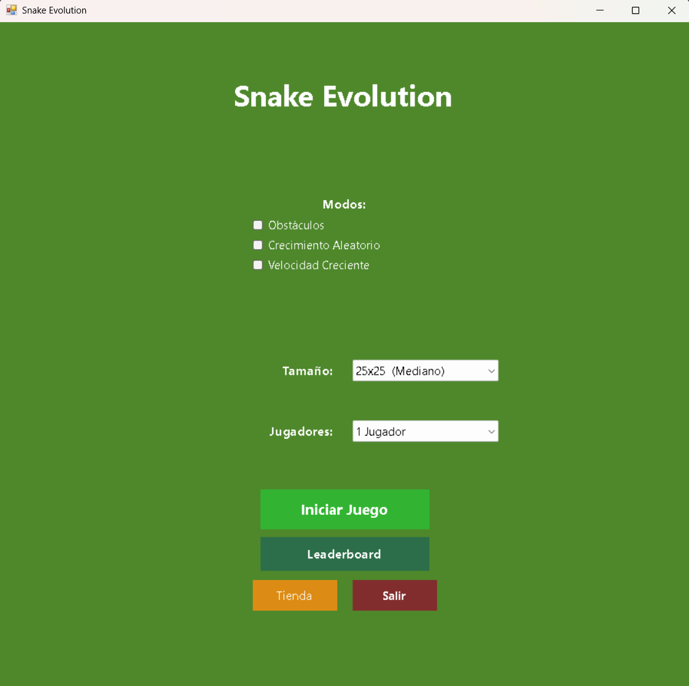
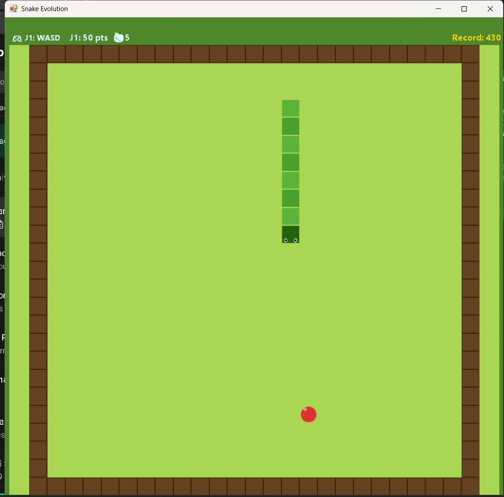
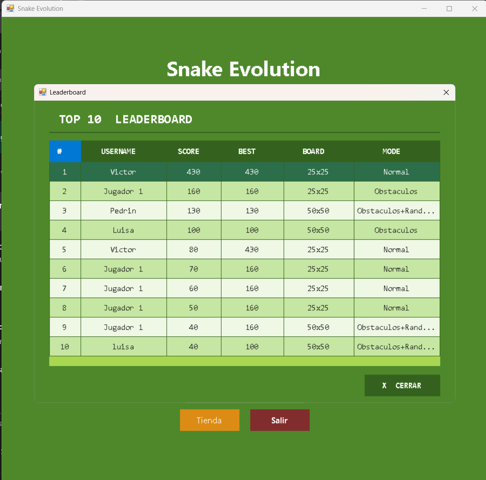
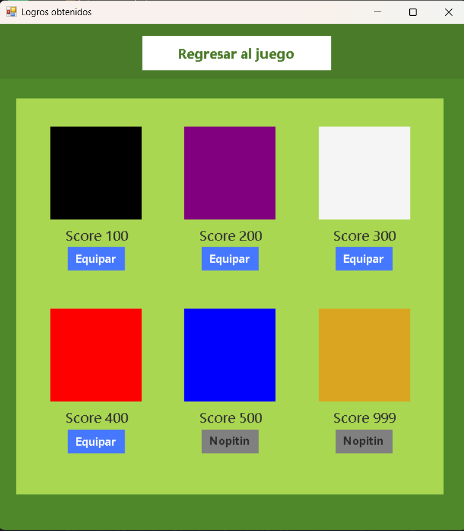
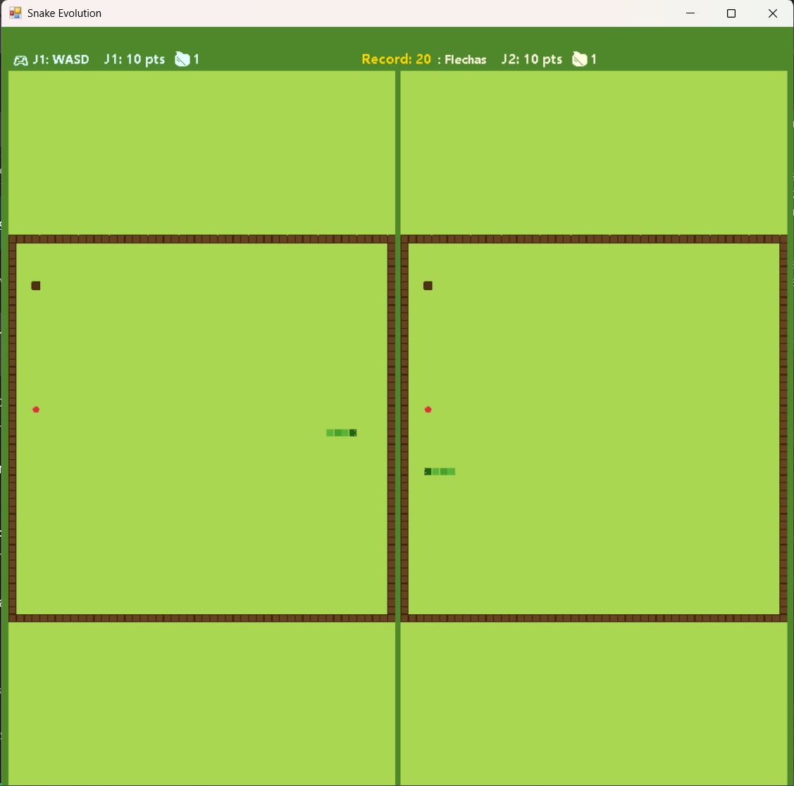

# Snake Evolution 🐍

Versión extendida del clásico *Snake* para escritorio, con modos de juego combinables, partidas de dos jugadores, tienda de apariencias y tabla de puntuaciones persistente.

## Capturas del juego

### Menu principal
</img>

### Partida en curso
</img>

### Leaderboard
</img>

### Imagen de la tienda
</img>

### 2 jugadores en tablero grande
</img>

## Funcionalidades

- **Modos combinables**: obstáculos, crecimiento aleatorio y velocidad creciente según el puntaje.
- **Tableros de tres tamaños**: chico, mediano y grande.
- **1 o 2 jugadores** en pantalla dividida: flechas para el jugador 1 y WASD para el jugador 2.
- **Tienda** para cambiar los colores de la serpiente.
- **Leaderboard** guardado en CSV con usuario, puntaje, tamaño de tablero y modo.
- Atajos: `P` pausa, `R` reiniciar, `M` menú, `L` leaderboard.
- **Documentación del código generada con Doxygen.**

## Diseño

- `SnakeGame` concentra la lógica del juego: movimiento, colisiones, crecimiento y modos.
- `ScoreManager` lee y escribe las puntuaciones en `snake_scores.csv`.
- Las ventanas (`form.h`, `formtienda.h`, `LeaderboardForm.h`) están separadas de la lógica.
- `modos.h` contiene una versión en C++ nativo del gestor de modos, como referencia de diseño.

## Cómo ejecutarlo

Requisitos: Windows y Visual Studio 2022 con **Desarrollo para el escritorio con C++** y **Compatibilidad con C++/CLI**.

1. Abre `Serpiente/Serpiente.sln`.
2. Compila en **Debug x64** y ejecuta.

## Autor

**Juan Alexis Martínez Morán** – Universidad Cuauhtémoc Querétaro
